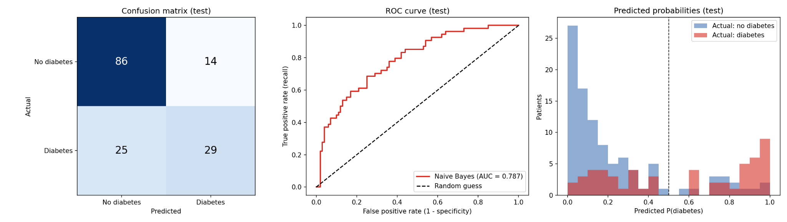
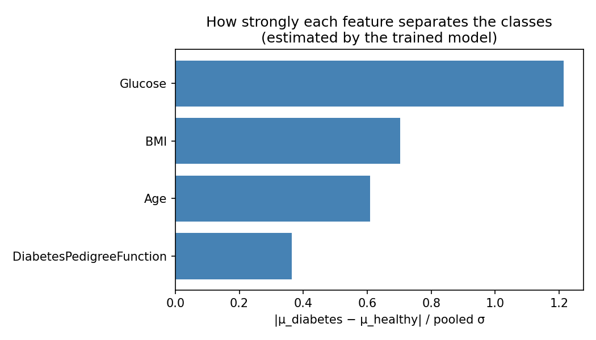

# Diabetes Prediction with Gaussian Naive Bayes

An academic machine learning project exploring binary diabetes classification on the Pima Indians Diabetes dataset. The Gaussian Naive Bayes classifier and evaluation metrics are implemented from scratch in Python using NumPy, with exploratory statistical analysis in R.

## Project highlights

- Exploratory data analysis (EDA) in R: descriptive statistics, density plots, boxplots, correlation matrices, Q–Q plots and missing-value analysis.
- Four-feature Gaussian Naive Bayes classifier with log-likelihood calculations, variance smoothing and numerically stable probability normalization.
- Stratified 80/20 train/test split (seed 42), training-only median imputation, and five-fold stratified cross-validation with fold-specific imputation.
- Evaluation against a majority-class baseline and verification against scikit-learn's `GaussianNB`. Scikit-learn is used for reference verification and cross-validation splitting, not for the custom classifier or evaluation metrics.
- Threshold analysis and 30 repeated stratified holdout splits to assess variability.

## Dataset

The Pima Indians Diabetes dataset contains 768 observations, eight original predictors and a binary target (`Outcome`: 0 = no recorded diabetes; 1 = recorded diabetes). There are 500 negative and 268 positive observations. The dataset originates from the National Institute of Diabetes and Digestive and Kidney Diseases (NIDDK).

A commonly used distribution is the [Pima Indians Diabetes Database on Kaggle](https://www.kaggle.com/datasets/uciml/pima-indians-diabetes-database). Obtain `diabetes.csv` from your dataset source and place it in the repository root. The CSV is not bundled pending confirmation of the exact source and redistribution terms. It is intentionally ignored by Git.

## Methodology

1. Analyze all eight predictors in R, including distributions, class separation, missing values, correlations and Gaussian assumptions.
2. Treat zero values in Glucose, BloodPressure, SkinThickness, Insulin and BMI as missing measurements. Retain valid zero values in Pregnancies.
3. Use four predictors in the final model: `Glucose`, `BMI`, `Age`, and `DiabetesPedigreeFunction`.
4. Split the dataset into 614 training and 154 test observations. Fit median imputation using training data only.
5. Estimate class priors, class-specific means and variances, then classify with Gaussian log-likelihoods.
6. Evaluate on the held-out split, perform five-fold cross-validation on the training subset, and assess stability over 30 repeated splits.

## Results

The following metrics were reproduced from the supplied dataset using the Python script (seed 42 for the main split).

| Metric | Holdout test | 5-fold CV (mean ± SD) |
| --- | ---: | ---: |
| Accuracy | 74.7% | 78.0% ± 2.7 pp |
| Balanced accuracy | 69.9% | 74.1% ± 3.3 pp |
| Precision | 67.4% | 71.7% ± 5.2 pp |
| Recall / sensitivity | 53.7% | 61.2% ± 6.1 pp |
| Specificity | 86.0% | 87.0% ± 3.0 pp |
| F1 score | 0.598 | 0.659 ± 0.047 |
| ROC AUC | 0.787 | 0.847 ± 0.023 |

The majority-class baseline achieved 64.9% test accuracy. The custom model agreed with scikit-learn's GaussianNB on all 154 test predictions. Across 30 repeated holdout splits, accuracy was 77.4% ± 3.3 percentage points and ROC AUC was 0.834 ± 0.030.



The test confusion matrix contains 86 true negatives, 14 false positives, 25 false negatives and 29 true positives. The moderate sensitivity is an important limitation.



## Reproduce the analysis

### Python

Tested with Python 3.13.5. From the repository root, with `diabetes.csv` in place:

```bash
python -m venv .venv
```

Activate the environment (Windows PowerShell):

```powershell
.\.venv\Scripts\Activate.ps1
```

On macOS/Linux: `source .venv/bin/activate`.

```bash
python -m pip install -r requirements.txt
python gaussian_naive_bayes.py
```

The script prints data summaries, predictions, metrics and validation results, saves plots and cross-validation CSV files under `results/`, and displays plots in an interactive environment. The current Python comments and console output are primarily in Armenian.

### R exploratory analysis

Install R and RStudio (with Pandoc available), then run from the repository root:

```r
install.packages(c("ggplot2", "knitr", "rmarkdown"))
rmarkdown::render("diabetes_eda.Rmd", output_dir = "docs")
```

This renders the R Markdown analysis as HTML. A rendered report is already included in `docs/diabetes_eda.html`.

## Repository contents

- [`gaussian_naive_bayes.py`](gaussian_naive_bayes.py): preprocessing, classifier, evaluation and validation.
- [`diabetes_eda.Rmd`](diabetes_eda.Rmd): R statistical analysis.
- [`results/`](results/): plots and per-fold validation metrics.
- [`docs/diabetes_prediction_presentation_en.pdf`](docs/diabetes_prediction_presentation_en.pdf): English presentation (PDF).
- [`docs/diabetes_prediction_presentation_en.pptx`](docs/diabetes_prediction_presentation_en.pptx): editable English presentation.
- [`docs/diabetes_eda.html`](docs/diabetes_eda.html): rendered English R EDA report (download and open in a browser).
- [`requirements.txt`](requirements.txt): tested Python package versions.

## Limitations and future work

The dataset is relatively small and population-specific; the findings are not necessarily generalizable. Gaussian distributions and conditional independence are approximate assumptions. Although imputation is fitted separately on training subsets, the original full-dataset EDA and prior feature selection may have influenced model design; the holdout results should therefore be interpreted as exploratory rather than fully independent validation. Thresholds shown on the test set are descriptive, not tuned deployment thresholds. Future work could use nested cross-validation for feature selection, assess calibration, and evaluate on an external dataset.

This project is for educational purposes only and is not intended for clinical diagnosis or medical decision-making.

## Author

Sona Aghabekyan — Machine Learning coursework, 2026.
